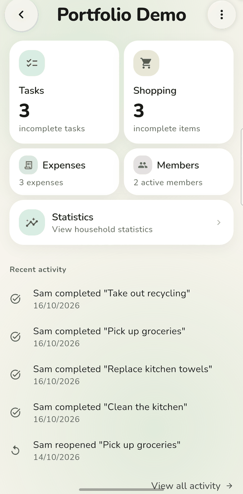
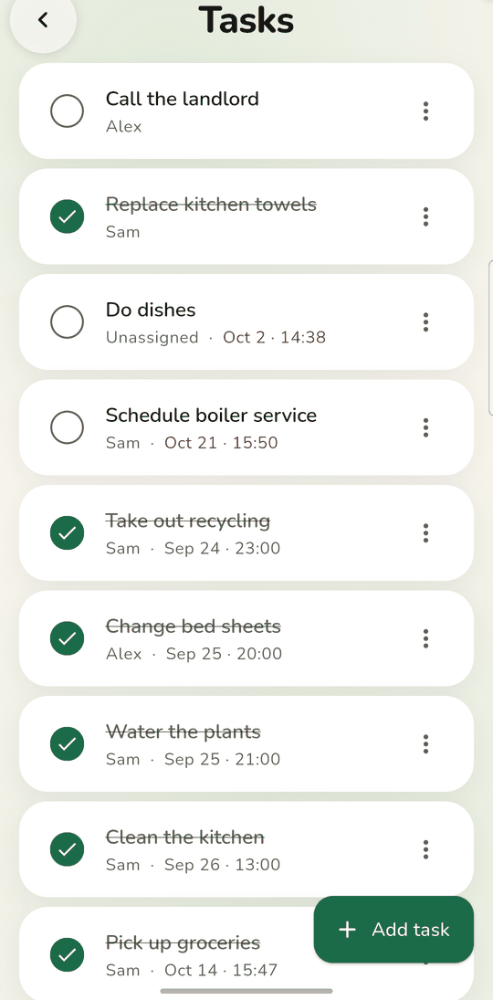
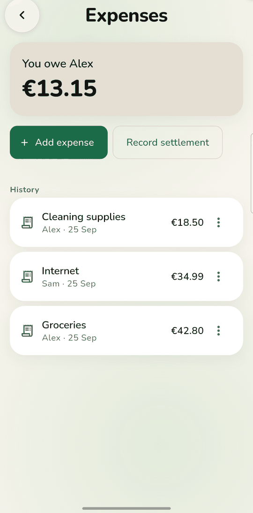
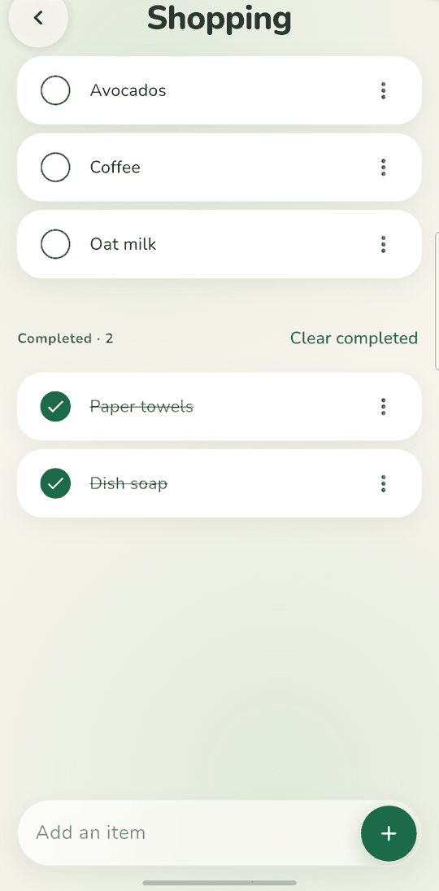
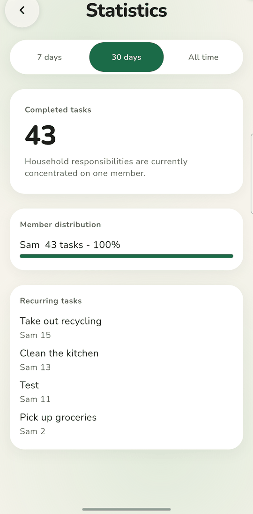
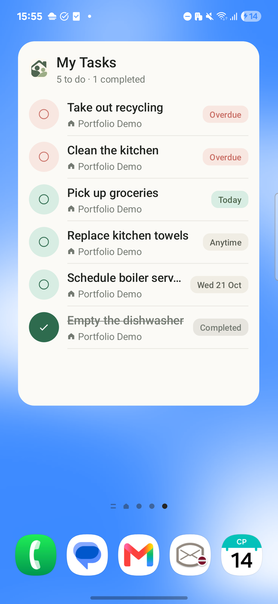
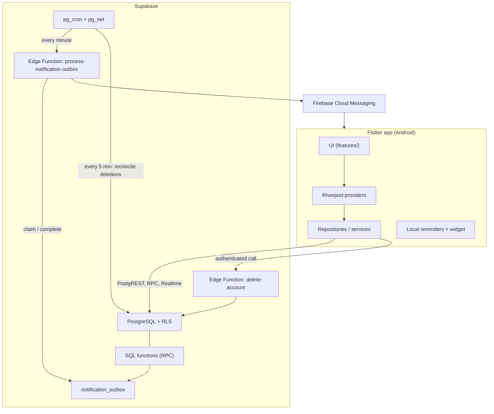

# Household OS

**Tasks, shopping and shared expenses for the people you live with — synced live, no signup form.**

[](https://github.com/mikhailesemchik-ui/HouseHold/actions/workflows/ci.yml)
[](https://flutter.dev)
[](https://supabase.com)
[](https://firebase.google.com/products/cloud-messaging)
[](#android-preview)

Household OS is a calm, minimal Android app for a shared home. One Today list shows what needs
doing across every household you belong to, a shared shopping list stays current, and a running
balance tracks who paid for what. Everything updates live for every member.

<table>
  <tr>
    <td align="center"><br><sub>Household dashboard</sub></td>
    <td align="center"><br><sub>Tasks</sub></td>
    <td align="center"><br><sub>Expenses and balance</sub></td>
  </tr>
  <tr>
    <td align="center"><br><sub>Shopping list</sub></td>
    <td align="center"><br><sub>Statistics</sub></td>
    <td align="center"><br><sub>Home-screen widget</sub></td>
  </tr>
</table>

<sub>Real screenshots from a physical Android device, running a debug build against the hosted
backend with demo data.</sub>

## Features

- **Today** — overdue, due today, upcoming and anytime tasks, across all your households at once.
- **Tasks** — one-off or recurring, with due dates, assignment, editing and completion history.
- **Shopping** — a shared list split into active and completed items.
- **Expenses** — who paid and how it is split, one net balance per pair of members, and
  settlements to clear a debt. Cancelled expenses are kept in an archive.
- **Households** — create or join by invite code, switch between several households, transfer
  ownership, remove a member.
- **Dashboard and statistics** — live counts, a recent-activity feed, completion trends and
  task-rotation suggestions.
- **Push notifications** — Firebase Cloud Messaging delivers a notification when someone assigns
  you a task (opt-in). The visible text is deliberately generic; details stay in the database.
- **Reminders and widget** — local reminders for due tasks and a native Android home-screen widget.
- **Account and privacy** — start anonymously, optionally link an email to protect and recover the
  account, and delete the account from the app (confirmation phrase plus an emailed code for
  linked accounts).

## Architecture



- **App** — Flutter with Riverpod 3 (`StreamProvider`s over Supabase Realtime for live data) and
  `go_router`. Code is organised feature-first (`lib/features/<feature>/{data,domain,presentation}`).
- **Data and access** — PostgreSQL with row-level security scoped to a user's households; multi-step
  writes go through SQL functions; triggers log household events and queue notifications.
- **Push** — a trigger writes to `notification_outbox`; a scheduled `pg_cron` + `pg_net` job calls the
  `process-notification-outbox` Edge Function, which claims rows atomically (at-least-once delivery,
  bounded retries) and sends them through FCM HTTP v1. The function is invoked with a dedicated
  secret header, not the service-role key.
- **Account deletion** — the `delete-account` Edge Function verifies the caller, runs the database
  cleanup, deletes the Auth user and finalises the account. An interrupted deletion is finished
  automatically by a scheduled reconciliation job.
- **Session recovery** — when the server rejects an access token, realtime streams refresh the
  session once and reopen; unrecoverable sessions fall back to the signed-out flow.

## Engineering

| Area | Status |
|---|---|
| Static analysis | `flutter analyze` reports no issues |
| Automated tests | 1050 Flutter tests pass (unit and widget) |
| Database | 51 versioned SQL migrations in [`supabase/migrations`](supabase/migrations) |
| SQL tests | RLS, financial integrity, account deletion, invite and push-token scripts in [`supabase/tests`](supabase/tests) (run against a local Supabase stack) |
| Edge Functions | Two functions in [`supabase/functions`](supabase/functions); the worker's authentication has automated tests |
| Verified end to end | Android push delivery on a physical device; in-app account deletion including Auth removal and reconciliation |

Not covered: iOS has not been device-tested, and there is no end-to-end UI test suite.

## Getting started

Requirements: Flutter (stable, 3.47 or newer), an Android SDK, and a Supabase project that has the
migrations from `supabase/migrations` applied.

```bash
flutter pub get

flutter run \
  --dart-define=SUPABASE_URL=https://<project-ref>.supabase.co \
  --dart-define=SUPABASE_ANON_KEY=<publishable-or-anon-key>
```

- Use the project's **publishable / anon** key only. Never put the service-role key in the app.
- To keep values out of your shell history, put them in a JSON file that is not committed (for
  example `.env.hosted.json`, which `.gitignore` already covers) and pass
  `--dart-define-from-file=.env.hosted.json`.
- Push notifications need your own Firebase project (`android/app/google-services.json`) and the
  Edge Function secrets named in the header comments of `supabase/functions/*/index.ts`.

```bash
flutter analyze
flutter test
```

## Android preview

Household OS is an Android preview and is **not published on Google Play**. Signed preview builds
are meant to be distributed through [GitHub Releases](https://github.com/mikhailesemchik-ui/HouseHold/releases);
Android asks you to allow installation from your browser or file manager the first time.

The `v1.0.0` APK on that page is an earlier build and predates the push-notification, account-deletion
and session-recovery work described above. An updated signed preview build will be attached to a new
release once it has been tested on a device.

## Project status

The app is feature-complete for its current scope and has been tested on a physical Android phone and
an emulator against a hosted Supabase project. Remaining work before any store release is device
testing of the release build, store listing material and a privacy policy. iOS builds from the same
code base but has not been validated.

## Project structure

```text
lib/
  app/            app shell, theme, routing
  core/           shared services (notifications, realtime recovery, config)
  features/       auth, expenses, homes, profile, shopping, startup, tasks, today
android/          Android project and native home-screen widget
supabase/
  migrations/     SQL schema, RLS, RPCs, triggers, scheduled jobs
  functions/      delete-account, process-notification-outbox
  tests/          SQL and shell integration tests
test/             Flutter tests, mirroring lib/
tools/device/     restricted wrapper used for on-device verification
docs/             design reference, manual test scenarios, screenshots
```

## Security

- Row-level security restricts every table to the households a user belongs to.
- Privileged operations (account deletion, notification processing) run in Edge Functions with
  service-role access that never reaches the client.
- Secrets live in environment configuration and Edge Function secrets, never in the repository;
  signing files and `.env.*` are git-ignored.
- This is backend-enforced access control, not end-to-end encryption.

## Contributing

This is a personal portfolio project and no license has been added yet, so all rights are reserved
by default. Issues and suggestions are welcome; please open an issue before sending a pull request.
