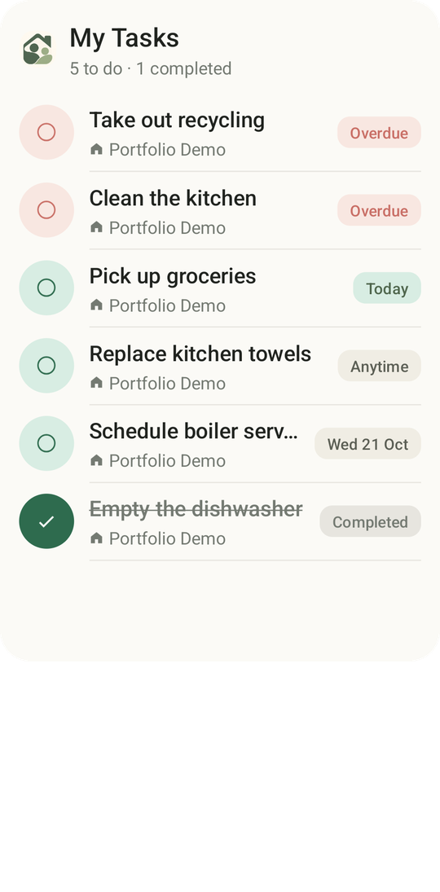
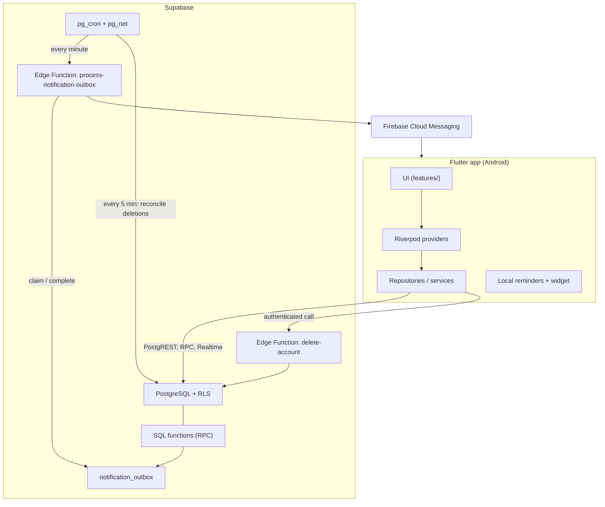

<p align="center">
  
</p>

<h1 align="center">Household OS</h1>

<p align="center">
  Tasks, shopping and shared expenses for people who live together.<br>
  An Android app built with Flutter, Supabase and Firebase.
</p>

<p align="center">
  <a href="https://github.com/mikhailesemchik-ui/HouseHold/releases/download/v1.0.0-preview.1/HouseholdOS-v1.0.0-preview.1-android.apk"><b>Download the Android preview (APK)</b></a>
  &nbsp;·&nbsp;
  <a href="#screenshots">Screenshots</a>
  &nbsp;·&nbsp;
  <a href="#architecture">Architecture</a>
</p>

<p align="center">
  <a href="https://github.com/mikhailesemchik-ui/HouseHold/actions/workflows/ci.yml"></a>
  
  
  
</p>

Household OS is for flatmates, couples and families who share chores, groceries and bills. One
**Today** list shows what is due across every household you belong to. A shared shopping list stays
current, and a running balance shows who owes whom. Changes appear on everyone's phone as they
happen, and you can start without an email or password.

## Screenshots

<p align="center">
  
  
  
</p>
<p align="center">
  
  
  
</p>
<p align="center"><sub>Dashboard · Tasks · Expenses · Shopping · Statistics · Home-screen widget</sub></p>

<sub>Captured on a physical Android phone with a debug build against the hosted backend. The
households contain demo data.</sub>

## How a household uses it

- Alex creates a household and shares its invite code. Sam enters the code and joins. A person can
  belong to several households, such as a flat and a family home, and switch between them.
- Alex adds "Call the landlord" and assigns it to Sam. Sam gets a push notification (if enabled) and
  sees the task under **Today**. Completing a recurring task finishes that occurrence only; later
  occurrences stay in place.
- Anyone adds "Oat milk" to the shopping list. It appears for everyone, and the item moves to
  Completed once someone checks it off.
- Alex pays €42.80 for groceries and splits it between both of them. Sam's expense screen shows the
  net balance, for example "You owe Alex €13.15", and **Record settlement** clears it.

## Features

| Area | What it does |
|---|---|
| Today | Overdue, due today, upcoming and anytime tasks from all households in one list |
| Tasks | One-off or recurring, due dates, assignment, editing, completion history |
| Shopping | Shared list with active and completed items |
| Expenses | Payer, equal split, one net balance per pair of members, settlements, archive of cancelled entries |
| Households | Create or join by invite code, transfer ownership, remove members |
| Dashboard and statistics | Live counts, activity feed, completion trends, task-rotation suggestions |
| Notifications | Push notification on task assignment (opt-in, generic text), local reminders for due tasks |
| Widget | Native Android home-screen widget; tasks can be completed from it |
| Account | Anonymous start, optional email link for recovery, in-app account deletion |

## Architecture



- **App:** Flutter with Riverpod 3 and `go_router`. Live data comes from `StreamProvider`s over
  Supabase Realtime. Code is organised feature-first under `lib/features/<feature>/{data,domain,presentation}`.
- **Data and access:** PostgreSQL with row-level security scoped to the households a user belongs
  to. Multi-step writes run in SQL functions. Triggers log household events and queue notifications.
- **Task model:** a task definition generates occurrences, and each completion belongs to an
  occurrence. That keeps history intact for recurring tasks.
- **Push:** a trigger writes to `notification_outbox`. A `pg_cron` and `pg_net` job calls the
  `process-notification-outbox` Edge Function every minute. The function claims rows with a lease
  (at-least-once delivery, five attempts) and sends them through FCM HTTP v1. Callers authenticate
  with a dedicated secret header; the service-role key is never used to invoke it.
- **Account deletion:** the `delete-account` Edge Function verifies the caller, requires a typed
  confirmation (plus an emailed code for linked accounts), cleans up in the database and deletes the
  Auth user. A scheduled job finishes deletions that were interrupted.
- **Session recovery:** when the server rejects an access token, realtime streams refresh the
  session once and reopen.

## Testing and verification

| Check | Kind | Result |
|---|---|---|
| `flutter analyze` | Static analysis, run in CI | No issues |
| `flutter test` | 1050 unit and widget tests, run in CI | All pass |
| Push worker authentication | 7 Node tests, run locally | All pass |
| `supabase/tests` | SQL and shell scripts for RLS, finances, account deletion, invites and push tokens, run locally against a Supabase stack | Not part of CI |
| Android push delivery | Manual, physical phone, debug build | Verified for task assignment |
| Account deletion | Manual, emulator, hosted backend | Verified, including Auth removal and reconciliation |
| Release APK | Manual, Android 16 emulator | Launch, onboarding, creating a household, navigation |

Not covered: the release APK on a physical device, push delivery with the release build, iOS, and
end-to-end UI automation.

## Getting started

### Try the app

1. Open the [latest preview release](https://github.com/mikhailesemchik-ui/HouseHold/releases/tag/v1.0.0-preview.1)
   on an Android 7.0+ phone and download the APK. The release notes list its SHA-256 checksum.
2. Open the file and allow installation from your browser or file manager when Android asks.
3. Open Household OS and tap **Get started**. The app uses a hosted backend, so there is nothing to
   configure.

> [!NOTE]
> This is a preview build distributed outside Google Play. The older
> [`v1.0.0`](https://github.com/mikhailesemchik-ui/HouseHold/releases/tag/v1.0.0) release is
> GitHub's default "Latest" entry, but it predates push notifications, account deletion and session
> recovery. Use `v1.0.0-preview.1`.

### Run the Flutter app

You need Flutter 3.47 or newer, an Android SDK, and a Supabase project that has this repository's
migrations applied.

```bash
flutter pub get
flutter run \
  --dart-define=SUPABASE_URL=https://<project-ref>.supabase.co \
  --dart-define=SUPABASE_ANON_KEY=<publishable-or-anon-key>
```

`flutter run` does not create a backend. Use the publishable or anon key only, and keep the
service-role key out of the app.

### Set up your own backend

Applying the migrations, enabling `pg_cron`, deploying the Edge Functions, setting their secrets and
connecting your own Firebase project are described in [docs/development.md](docs/development.md).

## Project structure

```text
lib/
  app/            app shell, theme, routing
  core/           shared services: notifications, realtime recovery, config
  features/       auth, expenses, homes, profile, shopping, startup, tasks, today
android/          Android project and native home-screen widget
supabase/
  migrations/     schema, RLS, RPCs, triggers, scheduled jobs (51 files)
  functions/      delete-account, process-notification-outbox
  tests/          SQL and shell integration tests
test/             Flutter tests, mirroring lib/
tools/device/     restricted wrapper for on-device verification
docs/             development setup, design reference, manual test scenarios, screenshots
```

## Security

- Row-level security limits each table to the households a user belongs to.
- Account deletion and notification processing run in Edge Functions. The service-role key stays on
  the server.
- Secrets live in environment configuration and Edge Function secrets. Signing files and `.env.*`
  are git-ignored.
- Access control is enforced by the backend. Data is not end-to-end encrypted.

## Status

Household OS is a personal project at preview stage: it works on a hosted backend and has been used
on a physical Android phone and an emulator. It is not on Google Play, and iOS builds from the same
code but has not been tested. The repository has no license file yet, so all rights are reserved by
default.
